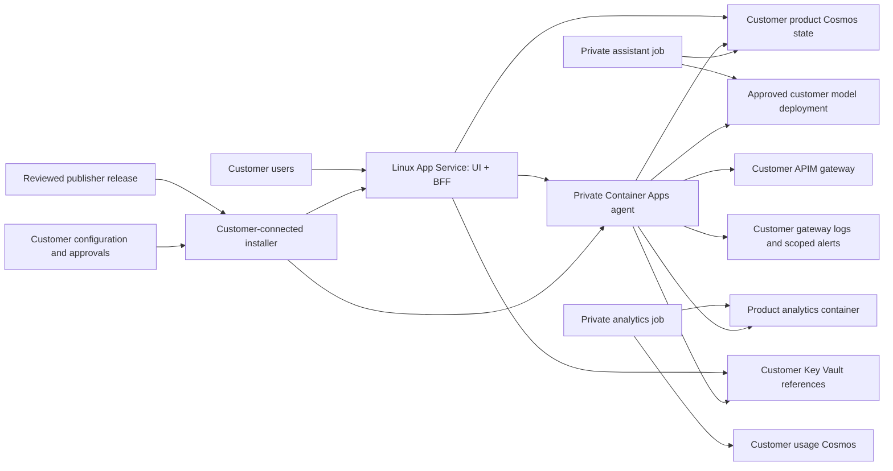

## Outcome and approval boundary

Build one reviewed release and deploy it into any supported customer's Azure
environment through validated customer configuration, without editing or
rebuilding application code for that customer.

Keep the tested architecture: React UI and Python BFF on Linux App Service,
private Container Apps agent, separate assistant and analytics jobs, Cosmos
state and analytics, and customer-owned gateway/data/model services.
This is a per-customer deployment product, not a shared publisher-hosted SaaS.

The requested deployment scope is now greenfield: assume no customer resources
already exist. Deploy APIM and its related gateway infrastructure using the
pinned upstream Bicep, then bootstrap product hosting and tenant identity,
and finally install the verified product artifacts. Preserve the existing-hub
installer as a separate compatible path.

Source commit/push is authorized as the first step. Image publication, Entra
changes and Azure provisioning still need their corresponding reviewed release,
target and apply approvals. No customer region, quota, policy or monthly cost
has been approved or validated. The CLI account is authentication context only.

## Non-negotiable portability rules

- Separate immutable release artifacts from customer deployment configuration.
  Changing customer tenant, subscription, resource names, region, network,
  identity or secret references must not require a source edit or rebuild.
- Never embed developer-specific Azure identifiers, credentials, local paths,
  resource groups, DNS names or network ranges in shipped artifacts.
- Keep secret values in customer-owned Key Vault or approved CI secret storage.
  Customer JSON contains identifiers and secret references, not credentials.
- Require explicit resource ownership and create/reuse modes. Never overwrite
  unrelated existing hosts, replace their networks or weaken their security.
- Resolve actual regional capabilities, policy, quotas, permissions and costs
  during each customer preflight. Do not assume a SKU works in every region.
- Unsupported configurations fail before provisioning, with an actionable
  reason. Unknown checks are not approvals and missing telemetry is not healthy.
- Preserve per-user/per-hub grants, disabled-grant revocation, independent
  production approval, PR-only assistant changes and no started-effect replay.

## Reference architecture

The private portal profile additionally restricts inbound App Service access
to approved customer networks. In both profiles, the agent has private ingress
and product data remains customer-owned.

### Resource ownership

| Resource                          | Default installation behavior                                               |
|-----------------------------------|-----------------------------------------------------------------------------|
| App Service plan, web app, BFF MI | Create dedicated resources or reuse explicitly approved hosts               |
| Container Apps environment/jobs   | Dedicated product hosting; validate approved reuse separately               |
| Product state and analytics       | Dedicated Cosmos resources, separate from source usage                      |
| APIM and source usage pipeline    | Deploy pinned upstream Bicep for greenfield; reference existing for reuse   |
| Model deployment                  | Provision an approved upstream-supported deployment or validate a reference |
| Key Vault and monitoring          | Create product-owned resources or validate approved references              |
| Networking and private DNS        | Create reviewed isolated networking or use approved topology                |
| Customer ACR                      | Optional unless the selected private-image profile requires it              |

Reusing shared services does not make their capacity, monitoring or operations
free. Reuse must preserve unrelated data and configuration and scope access to
the approved resources.

## Supported profiles and limits

Use these planning defaults because no customer-specific choices were supplied:

- Azure public cloud first, with customer-selected and validated regions
- Greenfield gateway/data/model infrastructure via upstream Bicep, with new
  product hosting; keep existing-hub and approved reuse modes separate
- Entra-secured public portal and private-only portal profiles
- Customer-owned infrastructure and identity in one Entra tenant per deployment
- Same-tenant cross-subscription references as a portability implementation goal

The current installer supports a narrower subset. The table below identifies
work to complete before advertising the expanded profiles.

| Area                 | Current implementation                                     | Planned customer-portable behavior                              |
|----------------------|------------------------------------------------------------|-----------------------------------------------------------------|
| BFF hosting          | Existing dedicated Linux app and BFF identity required     | Create or reuse dedicated Linux hosting                         |
| Subscriptions        | All resource references must share one subscription        | Explicit per-resource subscriptions within the same tenant      |
| Regions              | APIM and existing BFF must match                           | Validate real component constraints and approved regional paths |
| VNet                 | Creates an installer-owned VNet; rejects other integration | Create or reuse approved subnets, routes and DNS                |
| Private gateway      | Requires a supported Gateway private endpoint              | Supported PE or validated existing private-network connectivity |
| Private log queries  | Private-query-only workspace is rejected                   | Customer AMPLS integration, without public-query relaxation     |
| Registry             | Published anonymously pullable GHCR image                  | Verified public release or customer ACR with managed identity   |
| Release distribution | Same-repository Actions artifact with 14-day retention     | Durable versioned release, sealed installer and publisher trust |
| Customer installer   | Locally sealed existing-host tooling; publication pending  | Prebuilt verified installer for expanded supported profiles     |

Do not advertise Azure Government/China until cloud authorities, ARM/Graph
endpoints, DNS suffixes, SDK configuration, registries and service availability
have dedicated tests. Resolve endpoints through cloud descriptors and resource
metadata rather than scattered public-cloud string literals.

Windows BFF hosting, cross-tenant shared hosting, non-GitHub canonical providers
and AKS migration remain separate extensions. Greenfield gateway provisioning
is now in the deployment scope, but its orchestration is not implemented by
the current existing-host installer.

### Greenfield deployment sequence

1. Publish and review the source, retaining the pinned upstream submodule.
2. Select the customer tenant/subscription, region, naming, network profile,
   upstream feature flags, model deployment and budget limits.
3. Build a reviewed upstream parameter set and validate/preview the
   [upstream entrypoint](../upstream/ai-hub-gateway/bicep/infra/main.bicep).
   Deploy APIM, usage processing, storage, monitoring and approved optional
   resources through the original upstream modules, not duplicate portal IaC.
4. Validate source-pipeline operation and resolve the deployed resource outputs
   into the product's customer configuration.
5. Preview and provision the dedicated Linux App Service/plan, BFF identity and
   Key Vault prerequisites; perform explicit tenant-admin registration,
   secret enrollment, consent, user roles and BFF application-role assignment.
6. Run product infrastructure and application preview, obtain apply approval,
   then install the agent, workers, BFF and shared product state.
7. Complete actual identity/network/model/data and recovery acceptance before
   declaring the environment live.

Each deployment phase has its own resolved input/output and approval evidence.
Retries must reuse stable names and detect completed phases. Do not turn
upstream example defaults into an approved production profile or assume every
optional upstream service/model is available in every region.

## Release once, install many times

Publish a durable release containing:

1. Agent image and all job entrypoints, identified by immutable OCI digest
2. Self-contained Linux BFF ZIP with its verified native dependency closure
3. Installer container or equivalent sealed tooling bundle, including the
   Azure CLI, pinned Bicep, installer code and complete infrastructure modules
4. Versioned customer configuration schema and validation tooling
5. Release manifest, signatures/attestations, SBOM, licenses and support matrix

Bind the manifest to the product version, exact source SHA, agent/installer
digests, BFF ZIP hash, infrastructure/schema hashes, supported profiles and
runtime versions. Keep release files available beyond CI artifact retention.

Customer deployment workflows verify the trusted publisher, workflow/source
identity and artifact hashes before Azure authentication. The current
same-repository provenance check must be extended deliberately; do not remove
it or accept an arbitrary publisher supplied in untrusted JSON.

Support two artifact paths:

- Verified public release pull where customer egress permits it
- Approved customer ACR mirror/import for private or restricted environments

Use managed identity for customer ACR pulls, including all Container Apps jobs.
Validate registry network reachability and authorization before new revisions
start. A private-endpoint ACR profile requires Premium, not Basic. If copying
changes an OCI manifest digest, preserve an independently verified mapping to
the trusted original release rather than silently accepting a different image.

Customers should not need access to the developer's package mirrors, source
checkout, local machine or build caches. Build-tool dependency resolution belongs
in reviewed release CI, not web-app startup.

## Versioned customer configuration

Keep the existing strict
[installation configuration](../src/citadel_agent/portal/installation.py)
as the starting point. Introduce a new schema version for expanded profiles
instead of silently changing version-one semantics.

| Configuration group | Customer-controlled values                                        |
|---------------------|-------------------------------------------------------------------|
| Target              | Azure cloud, tenant, hosting subscription/group and regions       |
| Installation        | Stable installation ID, environment class, prefix and tags        |
| Hosting             | Create/reuse mode, approved host/identity references and SKU      |
| Existing services   | APIM, usage DB, model deployment, Key Vault and logs references   |
| Identity            | BFF/API registration IDs, audiences, scopes, roles and grants     |
| Secrets             | Separate client/GitHub Key Vault references and rotation policy   |
| Network             | Create/reuse mode, subnet IDs or approved CIDRs, routes and DNS   |
| Portal access       | Public-Entra/private-only profile, HTTPS origin and callback      |
| Registry            | Trusted release identity, public/customer-ACR mode and pull MI    |
| Monitoring          | Source workspace, optional pipeline IDs, AMPLS and retention      |
| Capacity/lifecycle  | Replica/RU limits, schedules, retention, backup and update policy |

Derive endpoints from validated resource metadata where possible. Detect
existing resources read-only and produce a candidate configuration for review;
never select the first discovered resource or silently switch subscriptions.

Preserve explicit `--subscription` and tenant checks. Use each reference's
subscription when resolving IDs and Bicep module scopes. Same-tenant
cross-subscription support must be tested with the actual scoped identities.

Generate names deterministically from the approved installation prefix,
environment and stable uniqueness seed. Retry/upgrade must not generate new
resource names or recreate state. Require customer-approved IPAM inputs; sample
CIDRs are examples, not safe universal defaults.

Produce a redacted resolved plan with a hash over configuration, release,
templates and relevant validation evidence. Changed input, expired evidence or
changed artifacts requires a new preview.

## Identity, governance and admin enrollment

Separate the following trust boundaries:

1. Customer deployment identity, using GitHub OIDC and narrowly scoped Azure
   provisioning/role-assignment permissions
2. Tenant administrator, responsible for Entra registration, consent and
   application-role assignment
3. BFF managed identity, authorized for product sessions/state, its client-secret
   reference and the private agent's application role
4. Agent managed identity, scoped to approved gateway/model/log/state access
5. Analytics identity, with source-read and analytics-write access only
6. Image-pull identity, limited to the approved registry
7. Effective portal user, resolved from session and exact hub grants

Provisioning privileges must never become an end-user role. Do not request
subscription Owner as the standard installation requirement. Document and
validate the specific scopes needed for each bootstrap/product phase.

For new hosting, use an explicit two-stage enrollment: create the stable BFF
identity and required hosts after bootstrap approval, let the tenant
administrator assign the API application role, then validate and apply the
product configuration. Otherwise the installer would depend on an identity
that does not exist yet. Neither stage may be disguised as a read-only preview.

Use dedicated customer registrations or explicitly approved compatible
registrations. Validate HTTPS origin/callback, tenant, audience, scopes,
application role and service principal. Keep secret/certificate enrollment and
rotation customer-controlled. Do not place secret values in configuration,
outputs, browser storage or release artifacts.

Verify real required checks, reviews, OIDC subjects and protected environments.
Independent production approvals remain required even for custom environment
names. The assistant continues to prepare PR-only changes; it cannot invoke
installation or deployment directly.

## Network profiles

### Public portal, private backend

Expose only the Entra-authenticated HTTPS portal. Use outbound App Service VNet
integration for the private agent/data path. The portal is not an anonymous
agent endpoint. Allow only reviewed runtime egress, including identity,
canonical GitHub and required service endpoints.

### Private-only portal

Use App Service private endpoints and disable public portal access only after
the approved private route and DNS are ready. App Service inbound private
endpoints and outbound VNet integration need separate subnets. Include both
site and SCM DNS records.

Use a customer-connected deployment runner with reachability to private SCM,
registries and health endpoints. OIDC establishes identity, not network access.
Do not assume a public hosted runner can reach customer-private services.

### Existing customer networking

Validate subnet delegation, address capacity, NSGs, UDRs, DNS forwarding,
peering and ownership. Preserve existing App Service integration unless
replacement is an explicitly approved migration.

Support approved existing private gateway routes instead of requiring every
internal APIM deployment to expose a Gateway private endpoint. Never enable
public gateway/data access as a connectivity workaround.

For private Monitor queries/ingestion, integrate with the customer's AMPLS and
shared DNS design. Azure Monitor query endpoints are shared; creating competing
AMPLS/DNS configurations can disrupt other customer workspaces. Do not create
an isolated scope without checking the existing topology.

## Customer installation flow

1. Select a verified release and supported installation profile
2. Collect customer inputs and perform read-only discovery/config validation
3. Validate tenant/subscriptions, existing resources, permissions, regional
   capabilities, quotas, policy, DNS/network paths and registry access
4. For create-hosting mode, preview and explicitly approve bootstrap; complete
   tenant-admin enrollment before product apply
5. Compile/validate infrastructure and produce ARM what-if, scoped permission
   changes, cost estimate and a hash-bound resolved installation plan
6. Review target identities, resources, networking, costs and destructive
   changes; obtain separate explicit apply approval
7. Apply owned resources and approved bindings, deploy BFF/image/jobs, and wait
   for actual readiness including the assistant heartbeat
8. Run real browser/identity/data/controlled-PR acceptance and record evidence
9. Publish a customer handoff containing versions, configuration hash, resource
   inventory, support boundaries, recovery and approved uninstall procedure

Preview remains the default. Schema validation, generic plan review and
infrastructure-generation approval never authorize Azure apply.

## Sizing and cost model

Offer evaluation, standard production and enterprise-private profiles. These
are capability bundles, not claims that one SKU fits every customer.

- Evaluation still needs a paid Linux App Service tier supporting VNet
  integration and Always On; F1/shared hosting is not a supported fallback.
- Production profiles require supported staging/update capacity, replicas and
  tested availability settings. Validate zone support rather than silently
  dropping redundancy.
- Private registry and network features add their actual required tiers.
- Parameterize Cosmos autoscale caps, worker schedules, retention, replica
  limits and diagnostic volume. Keep source usage costs separate from product
  hosting costs and include incremental shared-service effects.

Per customer, obtain portal concurrency, daily gateway-event volume, retention,
refresh/report targets, availability requirements and approved budget limits.
Use live regional prices with correct meter units and show assumptions for
RU consumption, logs, storage, network transfer, private endpoints and AI
inference. Unknown prices are not zero. No monthly quote is issued by this
unbound blueprint.

The local 100,001-event reconciliation test proves functional accounting,
not customer RU/latency sizing or a production-volume SLO.

## Upgrade, rollback and uninstall

Use the same release/configuration contract for first install and updates.
Show what-if and schema compatibility before changes. Support App Service
slots where the approved tier permits them and verified Container Apps
revisions/image rollback.

Preserve conversations, grants, approvals, audit and analytics state. Use
compatible schema evolution, controlled worker drain/admission and lease
fencing. Interrupted started effects remain review-required, not replayable.
Test restoration and rollback; do not treat re-running installation as recovery.

Uninstall removes only installation-owned resources and role assignments.
Preserve customer APIM, source usage/model resources, existing hosts, shared
networking and data by default. Data deletion needs a separate explicit
retention/ownership approval.

## Implementation sequence

| Phase | Deliverable                                                         | Depends on      |
|-------|---------------------------------------------------------------------|-----------------|
| D1    | Sealed installer, durable signed release and trusted distribution   | Design approval |
| D2    | Versioned config, resource discovery, resolved-plan/hash contract   | Design approval |
| D3    | Upstream greenfield gateway and create/reuse product-host bootstrap | D2              |
| D4    | BYO/private network, AMPLS, ACR and scoped multi-subscription paths | D2, D3          |
| D5    | Customer workflows, policy/cost/quota gates and lifecycle recovery  | D1, D2, D3, D4  |
| D6    | Portability matrix, real sandbox acceptance and install/runbook     | D5              |

D1 and D2 can be developed independently after design approval. The current
application and upstream gateway implementation remain unchanged unless a
verified compatibility issue requires a separately reviewed fix.

The first D1 implementation now produces a machine-neutral BFF and sealed
existing-host installer, including dependencies, schema and pinned templates.
The customer install workflow no longer checks out source or rebuilds
dependencies. Actual ZIP/native/isolated-entrypoint acceptance and 56 focused
packaging/install/infrastructure/release tests passed locally. Azure CLI/Bicep
remain runner prerequisites. Durable public release, trusted-publisher
extensions and D2-D6 expanded profiles remain pending; no live deployment
or publication is implied.

Key implementation surfaces:

- [Installation and validation](../src/citadel_agent/portal/installation.py)
- [Prepared-host deployment](../scripts/deploy_hosted.py)
- [Infrastructure modules](../infra/)
- [Publish workflow](../.github/workflows/publish-hosted.yml)
- [Customer install workflow](../.github/workflows/install-hosted.yml)
- [Artifact provenance](../.github/workflows/verify-hosted-artifact.yml)
- [Hosted operating guide](hosted-portal.md)

## Acceptance and release gates

Do not call the expanded customer installer complete until:

- The same trusted publisher release and BFF ZIP deploy to at least two
  independently configured customer sandboxes without customer-specific source
  edits; any customer-registry digest mapping is independently verified
- Configuration differences cover resource names, tenants/subscriptions,
  approved regions, create/reuse modes, networking and grants
- Supported private profiles prove site/SCM/registry/agent/data/Monitor paths
  and preserve existing resources without public-access workarounds
- Unknown/denied/policy-blocked/quota-insufficient configurations fail before
  resource writes; preview tests prove no create/role/deploy calls
- Changed configuration/artifact hashes and stale previews prevent apply
- Actual Entra sign-in, denied grants, cross-user isolation, disabled-grant
  revocation, independent approval and controlled PR-only flow pass
- Customer source accounting, missing telemetry/pricing and retention behavior
  reconcile; agreed load/RU/latency and cost limits are measured
- Clean release CI, artifact trust, backup/restore, upgrade, rollback and
  ownership-safe uninstall pass for the advertised support matrix

Real sandbox provisioning/model tests require explicit target and spend
approval. The existing local acceptance remains valid application evidence,
but does not satisfy these live customer gates.

## Authoritative networking references

- [App Service private endpoints](https://learn.microsoft.com/azure/app-service/networking/private-endpoint)
- [App Service VNet integration](https://learn.microsoft.com/azure/app-service/overview-vnet-integration)
- [Container Apps managed-identity image pulls](https://learn.microsoft.com/azure/container-apps/managed-identity-image-pull)
- [ACR Private Link requirements](https://learn.microsoft.com/azure/container-registry/container-registry-private-link)
- [Azure Monitor Private Link](https://learn.microsoft.com/azure/azure-monitor/logs/private-link-security)
