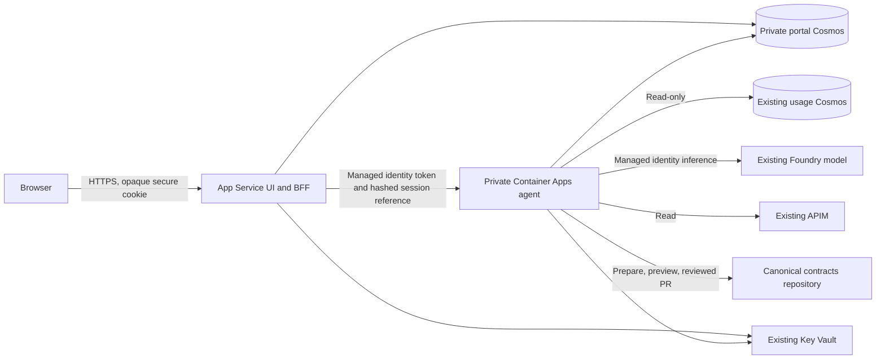

## Scope and delivery status

The portal provides three pages for platform teams:

- Gateway assistant: persistent private conversations, live/configured inventory,
  contract drafting, immutable change previews and explicit change review
- FinOps: usage and estimated model costs by model, deployment, product,
  application, backend and region; time and attribution filters; pricing coverage;
  daily charts and scoped CSV export
- Operations: request volume, HTTP 5xx and authentication failures, throttling,
  global P95 latency and investigation guidance from scoped APIM gateway logs

The browser uses a same-origin FastAPI backend-for-frontend (BFF). The BFF runs
in a dedicated Linux App Service; the agent runs in a private Container Apps
environment. Cosmos DB stores sessions, conversations, drafts, prepared snapshots,
approval evidence, audit events and execution status. Container-local working
clones are temporary and are never the durable source of truth.

The application, private-network Bicep, preview-first customer installation
workflow and prepared-host update workflow are implemented. The installer
provisions private hosting and deploys the applications in one workflow run
after customer prerequisites are configured. It does not create the existing
Linux App Service, gateway/model or customer Entra registration.
No live Azure installation or production acceptance has been completed.

The first hosted version connects existing APIM and Azure OpenAI-compatible
Foundry endpoints. Chat cannot create gateways or models. Model requests use the
agent's managed identity directly against the configured model endpoint;
automatic migration of those requests through the gateway is not implemented.

## Trust and authorization



The browser never receives an Azure access token, an agent service credential
or a client secret. The agent validates its BFF caller and loads the effective
user from shared session state. It never uses user IDs supplied in browser
headers or maps the agent managed identity's Azure privileges to the user's
persona.

Entra application roles and exact hub grants are separate requirements:

| Capability | Application role | Additional hub permission |
| --- | --- | --- |
| Assistant | Any known portal role | Exact hub grant |
| Inventory and operations | `Platform.Viewer`, `Platform.Operator` or `Platform.Approver` | Exact hub grant |
| FinOps | `Platform.FinOpsAnalyst` | `finops-data` |
| Custom FinOps attribution | `Platform.FinOpsAnalyst` | `finops-data`, `custom-dimensions` and configured administrator labels |
| CSV export | `Platform.FinOpsAnalyst` | Both `finops-data` and `exports` |
| Draft/submit changes | `Platform.Operator` | Exact hub grant; canonical policy also applies |
| Approve changes | `Platform.Approver` | Exact hub grant; independent approver for production |
| Raw-log assistant tools | Appropriate portal role | `raw-logs` |

Only a conversation's owner can retrieve its messages. Conversation history is
not exposed as a shared log search. Operators and approvers can review prepared
changes for their authorized hub.

Hosted assistant tools apply the same action/role/grant checks as the page APIs.
The tool registry refuses unclassified tools by default, and its wrappers
recheck authorization and audit each invocation without storing tool arguments.
Giving an analyst a raw-log grant alone does not bypass the raw-log role check.
The assistant's usage report uses the same data service as the FinOps page.

Bootstrap grants in deployment configuration are trusted administrator input,
not self-service role assignments. They do not replace Entra role assignment.
A durable Cosmos grant takes precedence. Remove a user's bootstrap grant from
deployment configuration when revoking access. Persist a durable grant with
`enabled: false` to deny all actions even while a bootstrap grant still exists.
Deleting a durable grant alone restores the configured bootstrap grant and is
not a sufficient revocation procedure.

### Change lifecycle

1. The operator asks for a draft and preview. Existing tools and the canonical
   change engine validate, render, compile and perform what-if where permitted.
2. The prepared change, rendered files and stored contract diff are persisted
   with their content hash and version evidence.
3. An approver reviews the actual stored preview in Change review. Approving
   arbitrary chat text does nothing. Production changes require a different
   approver from the author, including when the environment has a custom name.
4. An operator submits the exact approved change using its stored hash. The
   engine rechecks policy, repository, upstream and gateway versions.
5. Submission opens a canonical-repository pull request. GitHub review and
   deployment environment approvals remain separate gates.

Hosted changes are PR-only, even when development policy permits direct mode.
If that policy disables PR fallback, the hosted change is refused. The agent
does not have an `execute_change` chat tool. Key rotation requires the displayed
typed confirmation before submission.

ETags protect conversation and execution claims. New hosting templates enable
`CITADEL_PORTAL_DURABLE_TURNS_ENABLED=true` and a private scheduled
`assistant-worker` Container Apps job. The accepted user message, request hash,
verified session reference and queued work are stored atomically in the same
conversation document before HTTP 202. Browser polling and cancellation do not
depend on the accepting HTTP replica remaining alive.

The worker runs every minute with concurrency one and no automatic execution
retry. A global 90-second lease has an independent 30-second heartbeat; a turn
has a ten-minute lease and a model timeout also bounded by its session lifetime.
The worker rechecks the current session, exact hub grant, ownership and request
hash before starting. Tool invocations recheck current authorization. Acceptance
and readiness require a worker heartbeat observed within three minutes.

An expired claim that never started execution can return to the queue. Once the
execution-start checkpoint is stored, interruption fails the turn instead of
automatically replaying its model or tools. Cancellation invalidates stale
result writes; it does not undo an effect already submitted. Review drafts and
audit evidence before sending a new turn. Duplicate request IDs return their
current state, while conflicting payloads are rejected.

Older prepared hosts keep the default replica-local mode until their worker,
identity and durable-mode setting are deployed together. Durable records alone
do not make that compatibility mode a distributed queue.

A change with an uncertain submission result is marked `needs-review`, never
automatically replayed. An `executing` claim stale for ten minutes also requires
review and cannot be resubmitted. Inspect its canonical branch, PR and audit
record before preparing another change.

## Azure prerequisites

The [customer-portable deployment plan](customer-deployment-plan.md) defines
the proposed create/reuse, central-release and private-network extensions.
Those are planned profiles, not capabilities already accepted by the current
strict installer. Its prerequisites below remain in force until implementation
and customer validation complete.

Use the same tenant and, for this first topology, the same subscription for the
portal and hub. Host the BFF and private agent in the same region. The configured
canonical environment must match the selected APIM name, resource group,
subscription and gateway URL.

Prepare these customer-owned resources before first installation:

1. A dedicated Linux App Service with Python 3.11 and a plan supporting
   regional VNet integration. Do not reuse an unrelated application.
2. The existing gateway, usage Cosmos database, gateway Log Analytics workspace,
   Azure OpenAI-compatible model deployment and an RBAC-enabled, purge-protected
   Key Vault containing separate client and canonical-GitHub credential secrets.
3. A stable BFF user-assigned managed identity with the API's
   `Portal.InvokeAgent` application role already assigned by an Entra
   administrator. The installer checks the assignment without Graph writes.
4. The single-tenant app registration, callback, user roles and scope described
   below. Assign users both their Entra roles and exact hub grants.
5. A protected GitHub environment and a separate OIDC deployment identity with
   permissions to create the hosting group/resources, assign narrowly scoped
   Azure roles, add Cosmos SQL role assignments, approve the required private
   connections and configure the dedicated web app. Preflight also needs Graph
   read access to the supplied registrations, service principal and app-role
   assignments. Do not grant Graph write permissions to the workflow.

The installer creates:

- A dedicated hosting resource group and a VNet with separate delegated
  App Service and Container Apps subnets and a private-endpoint subnet
- Outbound-only NAT and a static egress IP for GitHub, Entra and other required
  public services; this is not public ingress to the agent
- An internal, zone-redundant workload-profile Container Apps environment and
  HTTPS-only agent with startup/readiness/liveness probes and two to five replicas
- A separate private, Entra-only Cosmos state account/container with `/id`,
  document TTL, continuous seven-day backup and an autoscale maximum of 1000 RU/s
- A new agent managed identity, scoped resource/data roles, private endpoints
  for state, usage, Key Vault and the model, plus a gateway private endpoint
  when supported and enabled
- Private DNS zones/links/records and a hosting diagnostics workspace

It adds the supplied BFF identity and VNet integration to the selected existing
web app, merges portal app settings and configures HTTPS, TLS and application
startup without redeclaring or replacing the site or its plan.

> [!IMPORTANT]
> Set the **environment** to internal, but the **agent app's ingress** to
> external (`external: true`, `allowInsecure: false`). In an internal environment
> this exposes the app only through the private load balancer. Environment-only
> app ingress (`external: false`) cannot be reached from App Service.
> See [Container Apps ingress](https://learn.microsoft.com/azure/container-apps/ingress-overview)
> and [App Service VNet integration](https://learn.microsoft.com/azure/app-service/overview-vnet-integration).

Use separate subnets for App Service integration, Container Apps and private
endpoints. App Service and ACA delegated subnets cannot be reused as general
private-endpoint subnets. Provide private DNS records for the ACA default domain
and private endpoint zones.

Production networking, zone redundancy, backup/restore, protected GitHub
environments, cost estimates, quotas and disaster recovery must be reviewed
before deployment. No such cloud readiness is implied by local unit tests.

### Entra configuration

The customer supplies the single-tenant application registration. Configure:

- A Web redirect URI matching `https://<portal-origin>/auth/callback`
- A delegated API scope, such as `api://<application-client-id>/access_as_user`
- The four user roles listed above, assignable to users/groups
- An application-only `Portal.InvokeAgent` role, assignable to applications
- Version 2 access tokens for the API
- An expiring confidential-client credential stored in Key Vault

Grant the BFF managed identity's service principal the `Portal.InvokeAgent` app
role on the API's service principal. This is an Entra app-role assignment,
**not** an Azure RBAC role. It requires an appropriately privileged tenant
administrator. The workflow does not assume tenant-wide Microsoft Graph write
permissions.

The BFF confidential client ID and BFF managed identity client ID are different
settings. `CITADEL_PORTAL_CLIENT_ID` identifies the OAuth client.
`CITADEL_PORTAL_BFF_SERVICE_CLIENT_ID` pins the managed identity's `azp` claim
inside the private API. The API audience must match the actual `aud` claim in
the emitted v2 token; do not assume the application ID URI and token audience
are interchangeable. The installer uses the API client GUID as the v2 audience
and requests service tokens with `api://<API-client-ID>/.default` through the
separate `CITADEL_PORTAL_AGENT_API_TOKEN_SCOPE` setting.

### Azure permissions

Grant only the required scopes:

- BFF: Cosmos data contributor on the portal database/container, plus read
  access to its client credential secret in Key Vault
- Agent: Cosmos data contributor on portal state; Cosmos data reader on the
  usage database and application analytics container; Reader on the selected APIM; Log Analytics Reader on the
  configured workspace; Cognitive Services OpenAI User on the selected model
  account; read access to the contracts GitHub credential secret
- Analytics worker: read-only usage database access and contributor access only
  to the analytics container; no portal sessions, vault secrets, model or gateway
  management privileges
- Deployment identity: deployment permissions only on the dedicated hosts;
  separate provisioning/RBAC permissions are necessary when infrastructure
  provisioning is later approved

What-if calls require additional ARM deployment/what-if permissions. Without
them, PR-mode preparation explicitly reports that the pipeline must run the
preview. No direct deployment permissions are needed for hosted execution.
Existing admin-policy caps, ownership, compatibility checks and production
PR-only rules are preserved.

Use a fine-grained GitHub credential scoped to the canonical contracts
repository with the contents/PR permissions it needs. Store it in Key Vault.
It is used in memory for HTTPS Git authentication and API calls; it is not
embedded in repository URLs, files or browser state.

## Runtime configuration

The base `CITADEL_PORTAL_` settings are listed in the
[README](../README.md#hosted-portal). Both processes use the same tenant, API
audience configuration and Cosmos state. Set:

| Additional setting | Use |
| --- | --- |
| `CITADEL_PORTAL_BFF_SERVICE_CLIENT_ID` | BFF user-assigned managed identity client ID, required by the hosted agent |
| `CITADEL_PORTAL_AGENT_API_TOKEN_SCOPE` | BFF token request scope, separate from the validated v2 token audience |
| `CITADEL_PORTAL_HUB_CONFIG` | Agent-only JSON matching the example below |
| `CITADEL_PORTAL_STATIC_DIRECTORY` | Optional BFF static asset directory; normally use the packaged UI |
| `CITADEL_PORTAL_MANAGED_IDENTITY_CLIENT_ID` | Each host's own user-assigned managed identity client ID |
| `CITADEL_PORTAL_ANALYTICS_CONTAINER` | Agent/worker analytics container, generated by the hosting template |
| `CITADEL_PORTAL_ANALYTICS_RETENTION_DAYS` | Worker-only event retention; default 93, bounded 1-366 days |
| `CITADEL_PORTAL_ANALYTICS_MAX_WORK_SECONDS` | Worker-only between-page work budget; default 240 seconds |

Example hub configuration, using placeholders only:

```json
{
  "scope": {
    "tenantId": "11111111-1111-1111-1111-111111111111",
    "hubId": "customer-gateway",
    "environment": "prod",
    "subscriptionId": "22222222-2222-2222-2222-222222222222"
  },
  "displayName": "Customer AI gateway",
  "apimResourceGroup": "rg-existing-gateway",
  "apimName": "apim-existing-gateway",
  "gatewayUrl": "https://apim-existing-gateway.azure-api.net",
  "contractsRepositoryUrl": "https://github.com/customer/contracts",
  "contractsBranch": "main",
  "githubTokenSecretName": "citadel-contracts-github-token",
  "usageEndpoint": "https://existing-usage.documents.azure.com:443",
  "usageDatabase": "ai-gateway",
  "usagePartitionField": "id",
  "modelEndpoint": "https://existing-model.openai.azure.com",
  "modelDeployment": "your-existing-chat-model-deployment",
  "modelApiVersion": "2024-10-21",
  "logAnalyticsWorkspaceId": "33333333-3333-3333-3333-333333333333",
  "maxUsageRecords": 20000,
  "initialGrants": [
    {
      "subjectId": "44444444-4444-4444-4444-444444444444",
      "scope": {
        "tenantId": "11111111-1111-1111-1111-111111111111",
        "hubId": "customer-gateway",
        "environment": "prod",
        "subscriptionId": "22222222-2222-2222-2222-222222222222"
      },
      "permissions": ["finops-data", "exports"]
    }
  ]
}
```

Use the actual usage container's partition field and database name. The
`llm-usage-container` and `model-pricing` names follow upstream. All connections
are deployment-owned; browser bodies cannot redirect queries to other accounts,
repositories, tenants or hubs.

The production agent requires hub configuration and the separate BFF service
client ID at startup. Unconfigured factory calls used in identity/unit tests
do not expose the product endpoints.

The scheduled `analytics` entrypoint requires only its Cosmos endpoint/database,
analytics container, managed-identity client ID and hub configuration. The
template omits initial user grants and the GitHub secret reference from worker
configuration. It runs every five minutes with one replica per execution.
Conditional database leases fence overlapping executions. It exposes no HTTP
ingress. Permission to start or override a job execution must remain restricted
to trusted deployment/operators because execution overrides can use its identity.

To support fixed-period costs, the customer separately configures
`completenessContainer` in hub JSON and connects an authoritative producer.
The worker only reads those assertions. See
[trusted completeness requirements](analytics-data.md#trusted-pipeline-completeness).

## Build and test locally

The frontend requires Node.js 24. Python and build dependencies remain locked
by `uv.lock`. The npm lock pins versions and integrity hashes but deliberately
omits registry-specific tarball locations, using npm's
`omit-lockfile-registry-resolved` option. Customers can use the public npm
registry or their approved mirror without inheriting a developer's private feed.
These commands do not authenticate to or modify Azure:

```powershell
npm ci --prefix frontend --ignore-scripts --no-audit --no-fund
npm test --prefix frontend
npm run build --prefix frontend
uv sync --locked --group build --all-extras --no-build-isolation
uv run --no-sync pytest -q tests -k "portal or hosted"
uv run --no-sync ruff check .
```

The build writes the SPA into `src/citadel_agent/portal/static/`, which is
ignored by Git but included in the installed wheel. The CI portal job builds,
tests and passes these assets to every Python packaging job.

With valid Azure configuration and network access, the service entry points are:

```powershell
uv run --no-sync python -m citadel_agent.portal.server agent
uv run --no-sync python -m citadel_agent.portal.server bff --port 8001
```

These entry points deliberately use managed identity in production. Running
them on a workstation without a managed identity does not silently fall back
to the developer's CLI identity. For developer integration tests, inject a
credential into the app factories. Browser authentication still requires a
registered HTTPS callback and trusted local TLS proxy. Production cookie and
CSRF protections are not disabled for local testing.

The UI unit tests and browser validation use explicitly mocked responses. They
do not send model requests, retrieve customer conversations or simulate a
successful Azure deployment.

### Artifact packaging

Run `publish hosted artifacts` from a reviewed commit on the default branch.
It builds and tests the UI, packages pinned upstream assets, builds the wheel,
creates a self-contained Linux App Service ZIP and sealed installer ZIP, and
builds the agent image.
It loads the actual Linux image and runs offline container acceptance before
allowing publication. It does not sign in to Azure. Image publication from
another branch is refused; `publish_image: false` remains build/test only.

Set `publish_image` to publish the image to GHCR. The image is tagged with the
source commit; use the reported digest for deployment. Make a public customer
release image anonymously pullable before installation. Private image registry
authentication is not assumed or silently configured.

The sealed installer contains its Python dependency closure, configuration
schema and reviewed Bicep modules. Its content map is verified before either
install/update entrypoint loads the product. Templates cannot be overridden
through the sealed install launcher. Azure CLI and Bicep 0.42.1 are prerequisites
on the approved Linux Python 3.11 deployment runner; they are not embedded in
this ZIP. This is the implemented existing-host profile, not the planned
new-hosting or broader cloud/network extensions.

Packaging omits build-origin `direct_url.json`, bytecode, lock files and
host-generated console launchers, and normalizes dependency RECORD entries.
Windows binaries or editable dependencies in the library closure are rejected,
not silently shipped to Linux.

The agent image is non-root, installs locked Python wheels, includes the
packaged portal assets and checks the pinned Bicep binary's SHA-256 digest.
ICU and a pre-extracted, read-only .NET bundle support Bicep under the non-root
runtime user without writing into the image filesystem. Package installation
does not generate bytecode inside the manifest-protected upstream assets.
The BFF ZIP targets Python 3.11 x64 manylinux 2.28 wheels rather than inheriting
the build runner's newer glibc ABI. It is not a Windows dependency bundle.
The build context excludes local secrets, developer state and `node_modules`.
The local Docker daemon must be running to build an image. A successful Python
or UI test run is not evidence that the container image was built.

### Local container acceptance

The production image was built and run locally on Linux/amd64. The acceptance
script verifies UID 10001, pinned asset hashes, native Linux dependency imports,
Bicep compilation and refusal to start an unconfigured production service.
It starts actual Uvicorn HTTP listeners for both app factories and verifies
liveness, readiness failure/recovery, anonymous authentication refusal and
all packaged UI routes/assets. Cloud state, OAuth and service-token boundaries
are explicit offline fixtures. It does not prove Azure identity, Cosmos access,
model inference, user sign-in or a customer installation.

Run acceptance with a read-only script mount, no network, a read-only root
filesystem and no added Linux capabilities:

```powershell
uv run --no-sync python scripts\prepare_hosted.py
docker build --platform linux/amd64 --tag citadel-agent:local-acceptance `
  --build-arg BICEP_VERSION=v0.42.1 `
  --build-arg BICEP_SHA256=aed90eb2c69a6ee2bd70dc0d4354408ac4d04fd9911d3ec8e0cd74ad173e7139 .
$smoke = (Resolve-Path scripts\smoke_hosted_container.py).Path
docker run --rm --network none --read-only `
  --tmpfs /tmp:rw,noexec,nosuid,size=64m `
  --cap-drop ALL --security-opt no-new-privileges `
  --mount "type=bind,source=$smoke,target=/checks/smoke.py,readonly" `
  --entrypoint python citadel-agent:local-acceptance -I /checks/smoke.py
```

The asset preparation command requires a clean generated-assets destination.
The local image tag is not a published release and cannot satisfy the
installer's publication-manifest check.

Publication also runs the smoke script with `--bundle` and `--wheel` mounts.
It checks exact package bytes and imports the extracted ZIP with isolated
Python and no global site-packages. This second check requires executable
scratch space for native Linux libraries; the separate image check retains
its no-execute temporary mount. Both checks run without network access,
with a read-only root filesystem and as UID 10001.

On restricted networks, add optional BuildKit secrets to the build command:
`--secret "id=npmrc,src=$HOME\.npmrc"` for an approved npm configuration and
`--secret id=pip_index,env=CITADEL_BUILD_PYPI_INDEX` for the approved Python
index URL supplied in that process's environment. Default builds still use
public registries. Mirror configuration is mounted only during dependency
installation, not copied into the runtime or encoded in build arguments.
Hash verification and TLS verification remain enabled. Do not copy developer
configuration into the build context or add credential values to the Dockerfile.

Generated runtime/UI directories are excluded from normal Hatch discovery and
included exactly once by the build hook. This keeps both Git checkouts and
Git-free Docker/sdist builds consistent; no Git ignore file is required for
packaging correctness.

## Deploy to prepared hosts

### First installation

Use the manual `install hosted product` workflow for first installation. Copy
[the strict installation example](../infra/install.example.json), replace its
placeholder values, and store the resulting JSON in the protected environment
variable `CITADEL_INSTALL_CONFIG`. It contains identifiers, reviewed network
prefixes and secret names, never secret values. Also configure
`AZURE_CLIENT_ID`, `AZURE_TENANT_ID` and `AZURE_SUBSCRIPTION_ID` for OIDC.
The deployment identity needs the Graph application permission
`Application.Read.All` (admin consent) for read-only identity preflight, not
`AppRoleAssignment.ReadWrite.All` or directory write permissions.

The default deployment runner is `ubuntu-latest`. For a private App Service
deployment endpoint or private portal origin, set the repository variable
`CITADEL_DEPLOY_RUNNER` to a trusted self-hosted **Linux** runner label with
the required routing and private DNS. Both first installation and updates use
this setting. It does not create a runner or open the agent to the internet.

Supply a successful publication run ID with `publish_image: true`, its reviewed
default-branch source SHA and the recorded, anonymously pullable image digest.
Both installer and update workflows reject an image digest that differs from
the artifact run's publication manifest. Older artifacts without a published
image manifest must be republished. The installer uses Bicep
from that exact source commit and validates the artifact checksum before Azure
sign-in. The install workflow checks both ZIP hashes, the source SHA and the
published image binding before extraction and Azure login, then runs the sealed
installer without checking out source or running pip/npm builds. Older artifacts
without the matching installer must be republished.
It verifies all resource references belong to the selected subscription,
pins the configuration subscription to the protected workflow environment,
derives the hosting region from APIM, and checks the existing Linux web app,
plan, origin/callback, model/usage/workspace endpoints and Entra app-role setup.

Run first with `apply: false`. This performs provider validation and ARM what-if
without changing resources. `apply: true` performs the same checks, then creates
the private topology, verifies the private connections are approved, configures
the selected BFF and deploys the verified applications. GitHub environment
approval and explicit apply are the deployment authorization boundary.
Nothing is deployed merely by generating or testing the repository files.

Local preview uses the same installer:

```powershell
uv run --no-sync python scripts\install_hosted.py `
  --config .azure\customer-install.json `
  --bundle build\hosted\citadel-portal.zip `
  --image "ghcr.io/customer/citadel-agent@sha256:<published-digest>"
```

Replace the digest placeholder with the actual 64-character published digest.
Adding `--apply` authorizes real provisioning and updates to the dedicated web
app. Never run it against an unrelated application or with an unreviewed config.

The preflight rejects overlapping/non-private networks, unsupported zones,
another existing App Service VNet integration, unrelated resources in the
target group and readdressing an existing portal VNet. Azure provider validation
must pass before what-if. The preview refuses deletes, incomplete/unsupported
changes, changes to referenced gateway/data/model resources, and unrelated
cross-scope writes. A full-payload preview is required so reruns distinguish
`NoChange` and `Modify` rather than ambiguous `Deploy` results. A failed
installation is not silently rolled back; inspect the ARM deployment and
retry the same reviewed configuration after resolving the reported failure.

Use non-overlapping RFC 1918 prefixes. The defaults are examples, not a customer
address-allocation recommendation. The default enables zones and checks the
subscription's regional zone mappings; ARM validation must also accept the
service-specific configuration. A customer in a region without zone support
must explicitly choose `isZoneRedundant: false` or a different approved topology.
The standard NAT egress gateway, single-region state and existing App Service
plan are not a multi-region or end-to-end availability guarantee.

Identity bootstrap and existing-resource access grants run before agent
creation. The hosting module deliberately depends on those access modules
so agent startup never blocks the deployment of its own Key Vault permission.
Normal Azure RBAC propagation can still delay readiness; failures are reported
and require inspection rather than an automatic permission bypass.

If APIM does not support a Gateway private endpoint, only set
`shouldCreateGatewayPrivateEndpoint: false` when the selected gateway is already
publicly reachable. This does not open or modify the gateway's network settings.
Private/internal gateways without supported private link need a separately
reviewed peering/topology extension. Do not relax their firewalls as a workaround.
Similarly, a gateway log workspace with public query access disabled requires
an Azure Monitor private-link topology extension; the installer stops rather
than relaxing that setting.

The installer adds APIM/log reader and model-inference access, usage data
reader at the configured database, and separate per-secret Key Vault access.
Existing account configurations and secret values are retained. The new state
account grants BFF/agent data contribution only at its state container.
No tenant app registration, user role, Entra consent or secret creation is
performed. Supply those prerequisites before running the installer.

Review the paid footprint before apply: two always-available agent replicas,
autoscale Cosmos, private endpoints, NAT/egress IP and log ingestion, plus the
existing web plan and model usage. No live cost estimate or quota guarantee is
implied by local compilation.

### Updates to existing prepared hosts

The `deploy hosted product to prepared hosts` workflow is manual-only and
defaults to validation without mutation. It never runs on a pull request.
It verifies a successful artifact-producing run on the default branch and its
source SHA, validates the ZIP checksum, then obtains Azure credentials through
OIDC in the selected protected GitHub environment.

Configure these environment variables:

| Variable | Meaning |
| --- | --- |
| `AZURE_CLIENT_ID` | Dedicated GitHub OIDC deployment managed identity |
| `AZURE_TENANT_ID` | Customer tenant |
| `AZURE_SUBSCRIPTION_ID` | Customer subscription |
| `CITADEL_WEB_RESOURCE_GROUP` | Resource group of the dedicated existing Linux App Service |
| `CITADEL_WEB_APP` | Existing App Service name |
| `CITADEL_AGENT_RESOURCE_GROUP` | Resource group of the prepared private agent app |
| `CITADEL_AGENT_APP` | Existing Container App name |

Use environment-subject federated credentials, for example
`repo:customer/repository:environment:production`, with issuer
`https://token.actions.githubusercontent.com` and audience
`api://AzureADTokenExchange`. Apply GitHub environment reviewers and deployment
branch restrictions. Tenant/application credentials are not required for OIDC.

Supply the artifact run ID, full source SHA, and published agent image digest.
Run once with `apply: false`. After reviewing the target hosts and permissions,
run with `apply: true`.

The update deployment preflight refuses public ACA environments, environment-only app
ingress, non-HTTPS ingress, missing VNet integration, Windows App Service,
mutable image tags and mismatched BFF/agent endpoints. It does not repurpose the
unrelated Windows web app found during local discovery.

Applying changes replaces the dedicated App Service's code and startup command
and updates the agent revision. The BFF's existing app settings and host
identities must already be configured. The ZIP includes Linux dependencies, so
remote Oryx builds are disabled. Use a network-connected runner if the App
Service deployment endpoint is private; do not open the agent to the internet.

For rollback, redeploy the previously accepted source artifact and image digest.
The workflow never deletes Cosmos data or changes the canonical gateway
contracts. A failed PR submission is not automatically retried.

## Data limitations

The FinOps browser uses per-user durable report runs. New hosting templates
configure maintained immutable analytics as the default input. Exact boundary
hours use normalized event facts; full hours merge stored rollups. An explicit
source-scan option exhausts the configured gateway's source pages across opaque
Cosmos feed ranges. Both paths checkpoint aggregate/cursor state and publish
results only when their input processing finishes.
Progress, cancellation and recent-report resume are available in the page.
CSV exports use the exact completed report ID and captured prices.

FinOps now has all six reference analytical tabs: Utilization, Heatmap,
Usage and Cost Overview, Model and Deployment Performance, Application and
Gateway Usage, and Peak Usage and Capacity Planning. New reports checkpoint
all profiles from the same input. Shared attribution/time filters, sorting,
exact-window drills and profile-labelled CSV are wired through the authorized
API. Maintained drills stay on the accepted generation until Refresh data
explicitly selects a newer one.

The portal does not copy every reference DAX behavior. In particular,
`GrandTotalTokens` in the pinned Power BI model ignores product filtering and
its visual `CostUSDX` column uses the simpler two-rate/percentage formula.
The portal preserves all filters, uses reviewed effective-dated extended pricing
and separates currencies. See [visual and numerical traceability](finops-parity.md).

This removes the browser's latest-N historical omission, not all production
analytics limits. Reports are on demand and client-advanced, expire after one
day and have explicit bucket/filter/record-size limits. Over-limit runs fail
instead of publishing partial financial totals. Source mutations and late
ingestion mean scan exhaustion is not a transactional snapshot or an ingestion
completeness guarantee. The legacy query/export endpoints and quick assistant
usage tool remain explicitly marked bounded previews.

There is no inferred completeness watermark, actual Azure invoice reconciliation,
forecast or automatic exchange rate conversion. Maintained hourly/daily rollups,
source-write-time delta refresh, daily hard-delete reconciliation and captured
price versions are implemented. This is not a change-feed processor or a
transactional source snapshot. Incremental generations currently copy observations
and rebuild derived rollups, so actual RU/storage/lag acceptance remains necessary.
Fixed-period allocations require matching trusted producer evidence; otherwise
they remain explicitly unpriced.
See [analytics semantics](analytics-data.md). Unknown quality is intentionally
distinct from healthy and zero. Pricing comes only from reviewed,
effective-dated entries; missing or malformed pricing is never invented.

Operations uses the resource-specific `ApiManagementGatewayLogs` table with
the exact APIM resource ID and requested event-time interval. Configure that
diagnostic destination first. Partial query results and missing diagnostics
are surfaced. The non-server-error percentage excludes HTTP 5xx, not HTTP 4xx;
it is not a synthetic availability SLO. No observed traffic is unknown quality,
not evidence of a healthy gateway.
Canonical inventory counts do not prove that every published endpoint is live.

### Operational investigation

Gateway filters use actual APIM columns: backend, product, subscription, region,
API and operation. FinOps/model/application filters are not silently applied to
gateway log rows. Usage attribution is a separate immutable-generation request
count by backend, model, deployment, region or application. It contains no cost,
token or custom-identifier projection and is not a response-code/latency join.
Groups are limited to 200 per dimension, with truncation reported as partial.

Request investigation requires Operations access plus `raw-logs`, an exact
APIM-generated correlation GUID and a UTC interval of at most seven days.
The fixed projection contains timestamps, selected identifiers, response codes
and durations only. Bodies, headers, URLs, IP addresses, trace text and raw
errors are excluded. Results are limited to 100 and explicitly marked partial
when limited. The assistant handoff only prefills an unsent investigation
prompt; it does not submit a PR, rotate keys or deploy.

Alerts and incidents reads fired Azure Monitor alert instances for the exact
configured APIM resource over at most the last 30 days. It does not retrieve
alert context or follow arbitrary pagination links. Missing permission, empty
results and source failure remain distinct. The managed identity needs
`Microsoft.AlertsManagement/alerts/read` for this resource. The installer does
not assert that customer alert permissions or rules already exist. Safe portal
links are read-only navigation, not acknowledgement or incident mutation.

The optional `hub.pipelineResources` installation setting maps `event_hub` to
an Event Hubs namespace, `processor` to a Logic App workflow or Function/Web App,
and `usage_store` to a Cosmos account. Only allowed resource types in the
configured subscription are accepted. Supply full ARM resource IDs and export
their supported count/total metrics to the configured Log Analytics workspace.
Missing configuration, missing diagnostics, denied reads, stale samples and
observed error/throttle counters have separate states. Average-only metrics
are not interpreted as zero. The maintained analytics generation also exposes
worker freshness and quarantine counts. Fresh telemetry is not an ingestion
watermark, a component probe or proof that all usage arrived.

Supported baseline reports pinned schema/catalog checks, including known
reference noise and real errors. The supported pin remains `23fbc8fe7f2f`,
master 1.0.2/routing 1.0.0. This check is not live deployed-contract drift or
certification of the newer upstream 1.0.3/routing 1.0.1. Circuit-breaker,
failover, cache and availability claims still require trustworthy source
signals and configured probes.

See the [product completion plan](product-completion-plan.md) for local
verification and release acceptance. The six-view implementation does not
establish live customer numerical parity or production-volume acceptance.

## Read-only release preflight

Run the local checker before requesting publication or deployment:

```powershell
uv run --no-sync python scripts\check_prelive.py `
  --repository akhilthomas011/citadel-agent `
  --manifest build\hosted\hosted-manifest.json
```

Exit code one means at least one blocked or unknown gate, not permission to
continue. The checker requires clean reviewable source, an exact source-SHA
and ZIP-hash match and an immutable published GHCR image. Local acceptance
images and unsigned/unpublished local manifests cannot pass publication.

For actual GitHub protection evidence, add `--remote`,
`--contracts-repository` with the customer repository, and repeat
`--required-check` for the actual reviewed check names. Select the real
`--branch` and `--environment`. The checker reads branch/environment policies;
it never changes them. It requires review and required-check enforcement,
stale-review dismissal, enforced administrators, no destructive pushes,
independent environment reviewers, self-review prevention, no bypass and
protected deployment branches. Absent/inaccessible metadata stays unknown.
Templates do not prove that these protections are enabled.

Reviewed source publication, anonymous image pull/provenance, customer
Entra/OIDC configuration, private connectivity and approved Azure provider
validation/what-if remain separate owner gates. No local check constitutes
deployment approval.

## Hosted acceptance checklist

Before calling the hosted product production-ready:

- Run the installer preview against actual customer configuration and review
  its permissions, network, cost and what-if results before authorizing apply
- Build and publish the container image; verify its startup, liveness/readiness
  probes, non-root execution and managed-identity dependency access
- Verify Entra login, expiry, logout, per-user conversation isolation and denied
  role/grant cases from a real browser
- Verify BFF-to-agent tokens use the expected audience, application role and
  managed identity client ID
- Compare dashboard totals with independently queried source records, including
  absent pricing, stale data, scan limits and multiple currencies
- Exercise a prepared PR-only change with a separate production approver, version
  drift rejection, replay rejection and canonical workflow gates
- Review retention, audit access, cost limits, backup restoration, concurrency
  and customer load/SLO requirements

No Azure resources were deployed as part of local implementation.

## Infrastructure validation

The following checks are local and do not require Azure sign-in:

```powershell
az bicep build --file infra\main.bicep --outfile build\infra\main.json
az bicep build-params --file infra\main.bicepparam --outfile build\infra\example.parameters.json
uv run --no-sync python scripts\prepare_infra_scan.py `
  --compiled build\infra\main.json --output build\infra\main.scan.json
```

The parameter file uses placeholders and must not be deployed as customer input.
Checkov's ARM reader needs array-shaped resource collections, so the scanner
adapter converts only compiled symbolic resource collections, preserving resource
bodies, conditions, copy expressions and nested templates. The adapted file is
scanner input only, never the deployed template. Compiled-property tests assert
the private ingress, identity, state, subnets, egress and scoped-role invariants.
CI also rejects a scanner result with zero checks or parsing failures.

CI runs the pinned Checkov version over this scanner input:

```text
uvx --python 3.11 --from checkov==3.4.0 checkov --framework arm --file build/infra/main.scan.json --skip-download --output json
```

On Windows, use the tool environment's `checkov.cmd` launcher if the bare
launcher is not resolved. Use your organization's approved package mirror when
public package access is restricted. No scan findings are suppressed by the
adapter.
